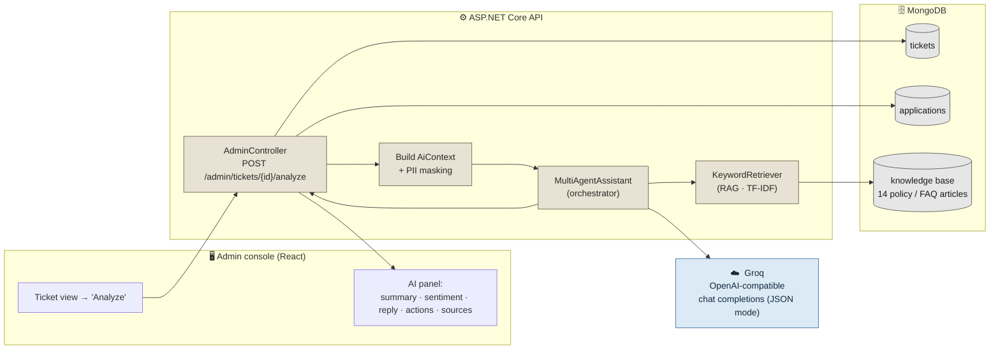
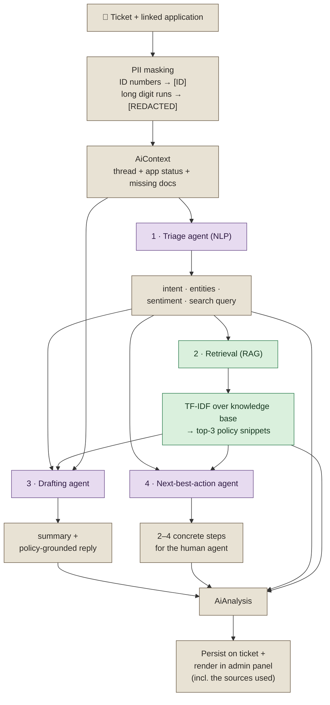
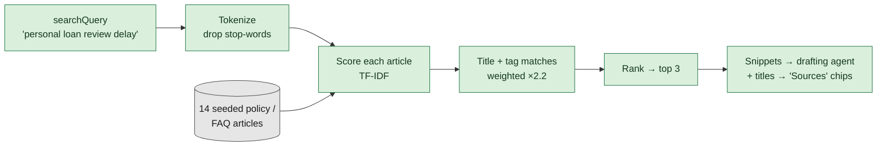
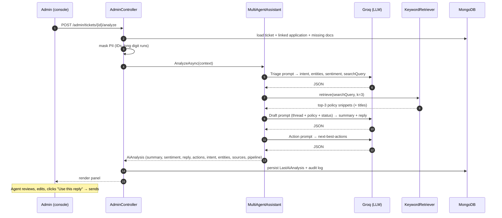

# AI Support Assistant

> A **multi-agent, retrieval-grounded** assistant that helps a human support agent answer a
> customer ticket — it reads the ticket *and* the linked application, retrieves the bank's own
> policy, and drafts a reply the agent reviews, edits, and sends. It **suggests; the human decides.**

When an admin opens a ticket and clicks **Analyze**, the backend runs a small pipeline of
specialised agents instead of a single generic LLM call. Each agent has one job — triage,
retrieval, drafting, next-best-actions — and the drafting agent is **grounded in retrieved
bank policy** so timelines and procedures are specific and correct, not invented.

---

## 1. Where it sits in the system

The context the orchestrator works from is **not just the chat thread** — it also pulls the
linked application's live state (product, status, risk level, automated flags, and which
required documents are still missing), so the answer is specific to *this* customer's situation.

---

## 2. The multi-agent + RAG pipeline

### What each agent does

| # | Agent | Input | Output |
|---|-------|-------|--------|
| 1 | **Triage / NLP** | Masked ticket thread | `intent`, `entities`, `sentiment {label, score, urgency}`, a `searchQuery` for the KB |
| 2 | **Retrieval (RAG)** | The triage `searchQuery` | Top-3 relevant bank-policy snippets + their titles (shown as **sources**) |
| 3 | **Drafting** | Thread + intent + **retrieved policy** + app state | A 2–3 sentence `summary` and a `suggestedReply` grounded in policy |
| 4 | **Next-best-action** | Thread + intent + policy + status | 2–4 concrete steps for the *agent* (not the customer) |

Agents 1, 3 and 4 are separate **JSON-mode** LLM calls to Groq; step 2 is pure retrieval
(no LLM). If the LLM is unavailable at the triage or drafting step, the whole request falls
back to a **deterministic offline assistant** that still produces every field — so the
feature is fully demoable with no API key.

---

## 3. Why RAG? (grounding, not guessing)

Without retrieval, an LLM asked "how long does a personal loan review take?" will *invent* a
plausible-sounding timeline. With RAG, the drafting agent is handed the bank's **actual**
policy snippet and told to ground every specific in it — so the reply says the real
**2–3 business day** SLA, and the UI shows exactly **which policy article** it used.

Retrieval sits behind the `IKnowledgeRetriever` interface, so the current **TF-IDF keyword**
retriever can be swapped for a **semantic (embeddings)** retriever without touching the
assistant. The knowledge base covers review timelines, required documents, status meanings,
rejection reasons, income verification, complaint escalation, and more.

---

## 4. End-to-end sequence

If any LLM call returns nothing, `MultiAgentAssistant` hands off to `MockAiAssistant`,
which reproduces the same pipeline shape (rules-based triage → RAG → template reply) so the
response is never empty.

---

## 5. What the assistant returns

A single `AiAnalysis` object drives the whole panel:

| Field | Meaning |
|-------|---------|
| `Summary` | 2–3 sentence recap of the ticket |
| `Sentiment` | `{ label, score, urgency }` from the triage agent |
| `SuggestedReply` | Draft the agent can edit and send ("Use this reply") |
| `NextBestActions` | 2–4 concrete steps for the agent |
| `Intent` / `Entities` | NLP triage output |
| `Sources` | Titles of the policy snippets RAG used (shown as chips) |
| `Pipeline` | The steps that actually ran (surfaced as transparency chips) |
| `Provider` | e.g. `groq:openai/gpt-oss-120b · multi-agent + RAG`, or `mock …` |

---

## 6. Safety & design principles

- **Human-in-the-loop.** The assistant only *suggests*. The agent reviews, edits, and sends —
  nothing is auto-sent to a customer.
- **PII never leaves raw.** Government ID numbers and long digit runs (card/account numbers)
  are masked *before* any text is sent to the LLM.
- **Grounded, not hallucinated.** The drafting agent must base specifics on retrieved policy
  and is told not to invent policy or promise approval; the UI shows the sources it used.
- **Graceful degradation.** No API key, or the LLM is down → a deterministic mock produces
  realistic, fully-populated analysis so the feature always works.
- **Pluggable.** The LLM provider (any OpenAI-compatible endpoint) and the retriever
  (keyword now, embeddings later) are both behind interfaces.

---

### Key source files

| Concern | File |
|---------|------|
| Analyze endpoint + PII masking | [`backend/Controllers/AdminController.cs`](../backend/Controllers/AdminController.cs) |
| Orchestrator + agents + Groq client | [`backend/Services/AiAssistant.cs`](../backend/Services/AiAssistant.cs) |
| RAG retriever | [`backend/Services/KnowledgeRetriever.cs`](../backend/Services/KnowledgeRetriever.cs) |
| Analysis model | [`backend/Models/AiAnalysis.cs`](../backend/Models/AiAnalysis.cs) |
| Knowledge base seed | [`backend/Data/DbSeeder.cs`](../backend/Data/DbSeeder.cs) |
