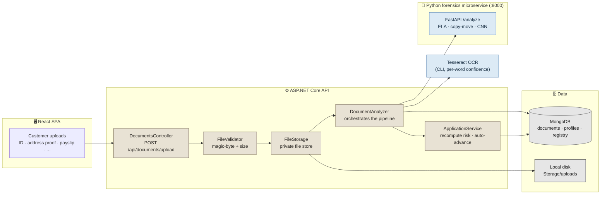
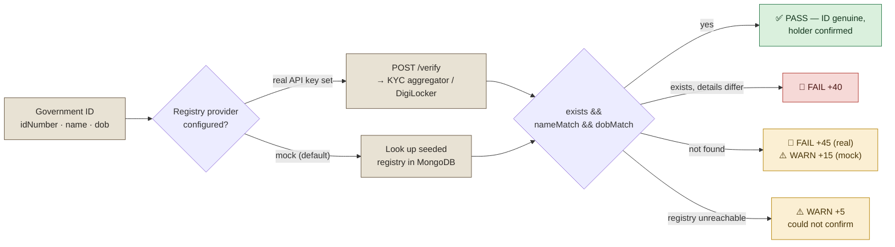
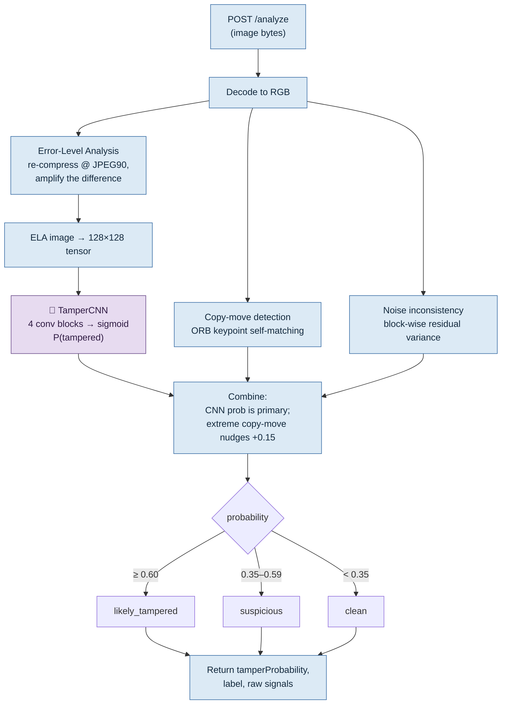
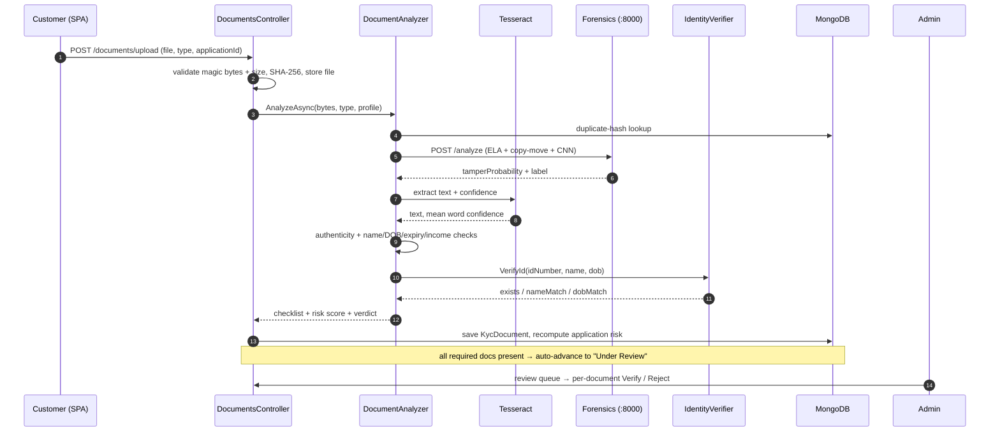

# Document Verification Pipeline

> How Veriqo turns an uploaded KYC file into an **explainable, evidence-backed verdict** —
> *Appears genuine* · *Needs review* · *Likely fraudulent* — without ever auto-deciding a customer's fate.

Every document a customer uploads passes through a layered pipeline: file-safety →
duplicate detection → metadata/forensic tamper analysis → OCR → authenticity →
field-level cross-checks against the profile → an **official issuer-registry lookup**.
Each layer contributes **pass / warn / fail** checks with a penalty; the penalties sum to a
risk score, and the score maps to a verdict a human reviewer acts on.

---

## 1. Where it sits in the system



The forensics microservice and OCR binary are **optional dependencies** — if either is
unavailable the pipeline *degrades gracefully* (that layer is skipped or flagged as a
warning) instead of blocking the upload.

---

## 2. The per-upload pipeline

```mermaid
flowchart TD
    A["📤 Upload received<br/>(≤ 6 MB, Customer role)"] --> B{"File-type valid?<br/>magic bytes = JPG/PNG/PDF"}
    B -- no --> BX["❌ Reject upload<br/>400 Bad Request"]
    B -- yes --> C["Save to private store<br/>+ SHA-256 hash"]

    C --> D{"1 · Duplicate?<br/>same hash exists"}
    D -- "other account" --> D1["🚩 FAIL +45"]
    D -- "own account" --> D2["⚠️ WARN +15"]
    D -- "no" --> D3["✅ PASS"]

    D1 & D2 & D3 --> E{"2 · EXIF metadata<br/>saved in an image editor?"}
    E -- "Photoshop / GIMP / …" --> E1["🚩 FAIL +40"]
    E -- "no" --> E2["✅ PASS"]

    E1 & E2 --> F["2b · ML forensics<br/>ELA + copy-move + CNN"]
    F -->|"likely_tampered"| F1["⚠️ WARN +15<br/>(supporting signal)"]
    F -->|"suspicious"| F2["⚠️ WARN +8"]
    F -->|"clean / service down"| F3["✅ PASS / skip"]

    F1 & F2 & F3 --> G["3 · OCR (Tesseract)<br/>text + mean word confidence"]
    G --> H{"Enough readable text?"}
    H -- no --> HX["🚩 FAIL +35 → stop & score"]
    H -- "yes, low conf <55%" --> H1["⚠️ WARN +12"]
    H -- "yes" --> H2["✅ PASS"]

    H1 & H2 --> I{"4 · Looks like the<br/>claimed document type?"}
    I -- "no markers" --> I1["🚩 FAIL +35"]
    I -- "markers found" --> I2["✅ PASS"]

    I1 & I2 --> J{"5 · Profile name<br/>on the document?"}
    J -- "no" --> J1["🚩 FAIL +25"]
    J -- "yes ≥50%" --> J2["✅ PASS"]

    J1 & J2 --> K["6 · Type-specific checks"]
    K --> L["🏛️ Official registry lookup<br/>(Government ID only)"]
    L --> M["Score → Verdict"]
    HX --> M

    M --> N{"Risk score"}
    N -- "0–24" --> N1["🟢 Appears genuine"]
    N -- "25–54" --> N2["🟡 Needs review"]
    N -- "≥ 55" --> N3["🔴 Likely fraudulent"]

    N1 & N2 & N3 --> O["Persist KycDocument<br/>+ recompute application risk"]

    classDef pass fill:#DAF0DD,stroke:#2E7D4F,color:#15371F;
    classDef warn fill:#FBEFD3,stroke:#B8860B,color:#4A3609;
    classDef fail fill:#F6D9D7,stroke:#B23A33,color:#4A1512;
    classDef proc fill:#E8E2D4,stroke:#6B5B47,color:#2B2824;
    class D3,E2,F3,H2,I2,J2,N1 pass;
    class D2,F1,F2,H1 warn;
    class BX,D1,E1,HX,I1,J1,N3 fail;
    class N2 warn;
    class A,C,F,G,K,L,M,O proc;
```



### Scoring at a glance

| Layer | Check | Trigger | Penalty |
|-------|-------|---------|--------:|
| File safety | Magic-byte + size | Not JPG/PNG/PDF, or > 6 MB | *rejected outright* |
| 1 · Duplicate | SHA-256 across **all** accounts | Match on another account | **+45** |
| | | Re-upload on own account | +15 |
| 2 · Metadata | EXIF "Software"/"Creator Tool" | Known image editor | **+40** |
| 2b · ML forensics | ELA + copy-move + CNN | `likely_tampered` / `suspicious` | +15 / +8 *(warn-only)* |
| 3 · Readability | OCR mean word confidence | Too little text | **+35** *(stops here)* |
| | | Confidence < 55% | +12 |
| 4 · Authenticity | Expected keyword markers | Zero markers for the type | **+35** |
| 5 · Name match | Token overlap with profile | < 50% of name tokens found | +25 |
| 6 · Government ID | ID number on document | Profile ID not found | +22 |
| | Date of birth | DOB mismatch | +15 |
| | **Expiry** | ID expired | **+50** |
| 6 · Address proof | Issue date recency | Older than 3 months | +20 |
| 6 · Salary slip | Income vs. declared | Gap > 15% | +25 |
| 🏛️ Registry | Issuer-registry existence | ID absent / holder mismatch | **+40 – +45** |

**Verdict mapping:** `score < 25` → *Appears genuine* · `25–54` → *Needs review* ·
`≥ 55` → *Likely fraudulent*. The score is capped at 100. The system **never
auto-approves or auto-rejects** — it hands the reviewer an itemised checklist and a verdict.

---

## 3. The official registry check — the authoritative signal

For a government ID, the single strongest signal is simply: **does this ID actually
exist in the issuer's registry, and does the registered holder match the profile?**
This is the DigiLocker-style existence check.



`IdentityVerifier` is interface-shaped: out of the box it uses a **seeded local
registry** (so the whole flow works offline for the demo), and setting a provider +
API key switches it to a **real government/KYC source** — the contract
(`{idNumber, name, dob}` → `{exists, nameMatch, dobMatch}`) stays identical.

---

## 4. Inside the ML forensics microservice

A standalone **Python / FastAPI** service (`ml-service/`) runs the heavier image
forensics so the .NET API stays lean. It is a **supporting** signal (warn-only): a model
miss can never flip a genuine document to "fraudulent" on its own — the registry and OCR
rules remain authoritative.



**`TamperCNN`** (PyTorch) takes the ELA image as input — edited/spliced regions
compress differently and "light up" under ELA, which the CNN learns to recognise:

```
ELA(128×128×3)
  → Conv(3→16)  BN  ReLU  MaxPool   → 64×64
  → Conv(16→32) BN  ReLU  MaxPool   → 32×32
  → Conv(32→64) BN  ReLU  MaxPool   → 16×16
  → Conv(64→64) BN  ReLU  MaxPool   → 8×8
  → AdaptiveAvgPool → FC(64→32) → FC(32→1)
  → sigmoid = P(tampered)
```

Classic forensics run alongside the CNN: **copy-move** (duplicated regions via ORB
self-matching) and **noise inconsistency** (spliced regions carry different sensor
noise). See [`ml-service/README.md`](../ml-service/README.md) for training and running.

---

## 5. End-to-end sequence



---

## 6. Design principles

- **Explainable, not a black box.** Every verdict is a list of named pass/warn/fail
  checks with human-readable detail — the reviewer sees *why*, not just a number.
- **Human-in-the-loop.** The pipeline scores and flags; a person decides. It never
  auto-approves or auto-rejects.
- **Defence in depth.** No single layer is trusted alone. The ML model is a *supporting*
  signal; the registry lookup and OCR field-checks are authoritative.
- **Fail-soft.** A missing OCR binary or a downed forensics service degrades to a warning,
  never a blocked upload.
- **Swappable.** Storage, OCR, forensics, and the registry all sit behind interfaces —
  swap in cloud OCR, blob storage, or a real DigiLocker provider without touching controllers.

---

### Key source files

| Concern | File |
|---------|------|
| Upload endpoint | [`backend/Controllers/DocumentsController.cs`](../backend/Controllers/DocumentsController.cs) |
| Pipeline orchestrator | [`backend/Services/DocumentAnalyzer.cs`](../backend/Services/DocumentAnalyzer.cs) |
| File-safety validation | [`backend/Services/FileValidator.cs`](../backend/Services/FileValidator.cs) |
| OCR engine | [`backend/Services/OcrEngine.cs`](../backend/Services/OcrEngine.cs) |
| Registry / DigiLocker check | [`backend/Services/IdentityVerifier.cs`](../backend/Services/IdentityVerifier.cs) |
| Forensics client | [`backend/Services/ForensicsClient.cs`](../backend/Services/ForensicsClient.cs) |
| ML microservice | [`ml-service/`](../ml-service/) (`app.py`, `forensics.py`, `model.py`) |
